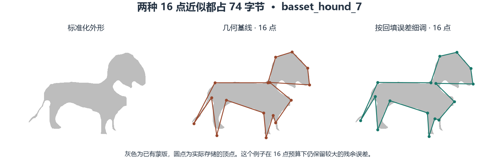

# 固定顶点预算下基于回填误差的二值外轮廓多边形编码

> **当前分支 POLY04-CONFIRM**　[独立确认结论](report/poly04/review.md) · [主次条件全表](report/poly04/tables.md) · [一次编码、离线审核与运行入口](report/poly04/README.md)。以下为旧阶段交接。

> **当前分支 POLY03-EXPLORE**　[开发结论与淘汰决定](report/poly03/review.md) · [真实实例与运行入口](report/poly03/README.md) · [新确认计划](records/poly03/next-confirmation.md)。以下正文保留此前 POLY02 与 v1 的交接。

> **本轮主控审核 POLY02**　[结论与反例](report/poly02/review.md) · [代码、演示和复算入口](report/poly02/README.md) · [冻结协议](records/poly02/freeze.md)。以下正文保留 v1 的实验与交付记录。

标注编辑器常把一块现成的前景蒙版导出成可以拖动顶点的多边形。传统简化按轮廓到直线的距离挑点。这里用同样多的顶点，把结果填回原尺寸，直接数多填和漏填的像素，再移动顶点。输出包含宽、高、顶点数和全部坐标，16 点文件 74 字节，32 点文件 138 字节。

在 100 张独立 Oxford-IIIT Pet 真实标注上，相对开发阶段最强的几何细调，按照片等权的误填像素平均减少 **7.12%**，95% 配对区间 **6.35%–7.99%**，99 张改善、1 张退化。平均 IoU 从 0.97609 增至 0.97773，编码平均多用 17.48 ms。结论适用于已有单目标外轮廓的离线编码。完整多部件蒙版、毛发分割精度与人工编辑耗时各有不同的评价目标。

| 审核入口 | 内容 |
|---|---|
| [结论、案例与适用边界](report/findings.md) | 候选选择、指标解释、反例与表格 |
| [原图逐张结果](results/confirm/per_image.csv) · [源照片配对结果](results/confirm/paired_by_source.csv) · [不确定性](results/confirm/paired_summary.csv) | 两档预算、所有有损与无损对照 |
| [开发逐图表](results/dev/per_image.csv) · [参数筛选](results/screen/per_image.csv) · [淘汰实验](results/thumbnail/paired_summary.csv) | 开发与确认来自互斥照片、互斥品种 |
| [协议](records/freeze.md) · [输出判定](results/confirm/decision.json) · [样本逐一哈希](records/samples.csv) | 确认前公开到本私有仓库的冻结点为 ed8c4ede27f1e4a28b0d4c6d48cf5d569593dac7，标签 selection-freeze-v1 |
| [四个候选](records/candidates.md) · [去留](records/decisions.md) · [查新与资源](records/research.md) | 最近工作的差异及未复现项 |
| [核心改动](src/method.py) · [基线](src/baselines.py) · [字节格式](src/codec.py) · [环境](records/environment.md) | 含单位检查和小规模穷举校验 |
| [正式实验与 Word 提纲](report/plan.md) · [执行进度](records/progress.md) · [旧项目交接](records/old-project.md) | 后续工作、课件页码和归档说明 |
| [固定审核包与 SHA-256](https://github.com/Jupiter0914/dip-final-project-lab/releases/tag/topic-confirmation-v1) | 含全体 136 张原标注及 1,632 份编码输出，可离线从像素复算 |



## 离线复算

解压 Release 的 outline-review.zip，进入含本 README 的目录。通过普通 Python 3.12 和 requirements.txt 所列环境即可。Windows 原机使用 E:/Miniconda/envs/pytorch_cv/python.exe。依赖已备好时无须联网或 GPU。

```powershell
python -X utf8 scripts/replay.py
```

它核对内部文件清单与冻结文件哈希，独立解码 1,632 个多边形，通过另一套逐像素与边界匹配实现复核 FP、FN、IoU 和边界 F，从 136 张源标注重算主指标与置信区间。还重新拟合四个确定案例的两种方法、两档预算，并比较精确的编码字节。BUNDLE-INFO.json 指向生成该包的提交。带宽与磁盘读写受机器影响，原始计时保留于 CSV。

## 一张图的演示

在审核包根目录可直接使用附带的示例。独立 Git 检出先按下节取得数据。一般二值图用非零值表示前景；读 Oxford 的索引 PNG 时指定 --oxford。编码取最大外轮廓、填平其孔洞。空前景、无法支持预算的轮廓会报告错误。

```powershell
python -X utf8 scripts/polygon.py encode data/trimaps/leonberger_22.png local/demo.poly --oxford --vertices 16
python -X utf8 scripts/polygon.py decode local/demo.poly local/demo.png
```

将 --method geometry 加到 encode 命令可从同一个输入导出几何对照。顶点坐标按图像原点在左上角、横坐标在前排列。解码器只需多边形文件。

## 从私有 Git 检出重跑

以下命令从正常克隆、含 selection-freeze-v1 标签的仓库根目录运行。推荐 Python 3.12 的独立环境。新安装依赖时先运行 `python -m pip install -r requirements.txt`。归档下载约 19.2 MB。可改用本机已有上述解释器，所有命令的 python 替换为对应路径即可。已提交的逐图表通过 --output 放到另一目录复现；每次命名新的目录。

```powershell
python -X utf8 scripts/prepare_data.py --check
python -X utf8 scripts/check_math.py
python -X utf8 scripts/verify_lock.py
python -X utf8 scripts/study.py screen --output local/reproduce-screen
python -X utf8 scripts/study.py dev --output local/reproduce-dev
python -X utf8 scripts/summarize.py local/reproduce-dev
python -X utf8 scripts/study.py confirm --output local/reproduce-confirm
python -X utf8 scripts/summarize.py local/reproduce-confirm --decision
```

开发与确认使用同一环境、代码和固定配置。确认脚本拒绝已存在的输出目录，并检验冻结标签中的哈希。单图完整输入与源码、原始逐图数据格式、数据署名、已验证功能及局限见本库记录。[数据与署名](records/attribution.md) · [工具使用和版本](records/environment.md)
