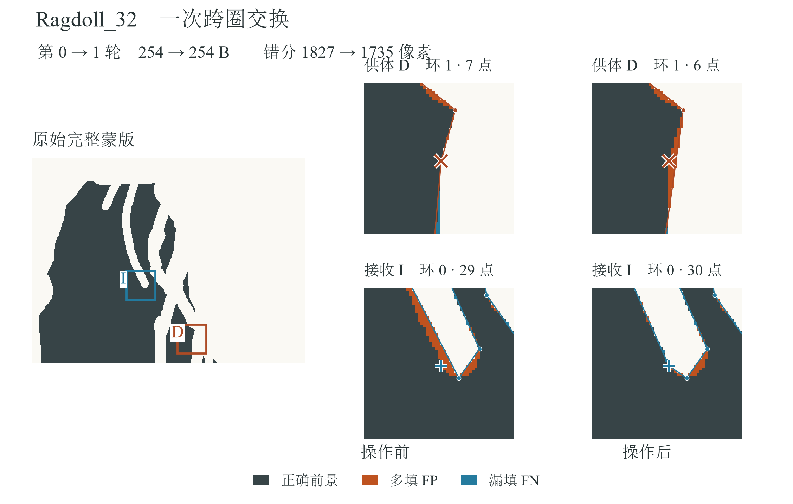

# 限时交付下保持部件与孔对应的二值蒙版多边形编码

数字图像处理课程项目。一张宠物蒙版可能有几块分离的前景，腿和躯干之间还可能围出一个孔。如果整张图只能存成 256 字节的多边形文件，哪个轮廓最值得多用一个顶点？

我们让两个编码器从同一组顶点开始。一个只能在同一圈内移动顶点（`within_full`），另一个还可以把一个顶点转给另一圈（`cross`）。两者都要把结果写成可独立解码的 PM31 文件，并在回填后逐一核对前景部件、孔及其邻接关系。

**在 Oxford 的 146 个可配对多环蒙版上，允许跨圈平均少错 2.26 个像素，中位数为 0。** 这一收益集中在部分形状上。外部 LEMS 数据只有 7 个可配对多环形状，尚不足以确认跨数据集的稳定收益。[逐源结果](results/poly04/confirm/analysis/source_pairs.csv)

## 看一个点怎样改变结果

下图是同一张 `Ragdoll_32` 在一次编码中连续交付的两份文件。内圈从 7 点减到 6 点，外圈从 29 点增到 30 点。两份文件都是 **254 字节**，回填后整图的错分从 **1,827 降至 1,735 像素**。这是一次顶点转移减少的 92 个错分像素。同次实验的圈内方法交付了 1,789 个错分像素，两种方法之间相差 54 个。[图注与原始文件](report/poly05/figures.md)



**想自己查看案例**，下载下方回放包并完整解压，双击 `report/poly05/replay/index.html`。选择 `Ragdoll_32` 可查看这次转移，也可切换到持平、退化和孔缩小的案例。八个案例均可断网查看。[下载离线回放包（ZIP，约 8 MB）](https://github.com/Jupiter0914/dip-final-project-lab/releases/download/poly05-replay-v1/poly05-replay.zip) · [附件校验值](https://github.com/Jupiter0914/dip-final-project-lab/releases/tag/poly05-replay-v1)

## 怎样读实验结果

主条件是 **文件最多 256 字节，调用方在 100 毫秒内收到**。我们用原蒙版和解码蒙版逐像素比较，把多填与漏填相加。下表只比较同一来源、同一会话、同一次重复中，两种方法均及时交付且实际文件一样长的多环样本。重复测量先在来源内汇总，再对来源等权平均。正值表示跨圈少错。

| 数据来源 | 确认输入总数 | 可配对多环来源 | 配对调用数 | 平均少错像素（95% 源级区间） |
|---|---:|---:|---:|---:|
| Oxford-IIIT Pet | 200 | 146 | 871 | 2.26 [0.64, 4.01] |
| LEMS | 100 | 7 | 42 | 0.43 [0.00, 1.29] |

及时交付率以**全部预定调用**为分母。Oxford 的跨圈和圈内方法分别交付 1,165/1,200 和 1,166/1,200 次，LEMS 均为 528/600 次。100 毫秒按接收器收到字节的时刻判断，搜索可以继续，函数返回和写盘还会更晚。结构验收也有边界，例如一个孔仍能与原孔对应，面积却从 271 缩至 96 像素。[统计口径与计时字段](report/poly05/corrections.md) · [覆盖表](results/poly04/confirm/analysis/coverage.csv) · [孔面积案例](results/poly05/figures/05-structure.png)

## 复算与运行

**复算实验数字。** 在完整 Git 克隆的根目录，用 Python 3.12 环境运行以下两条命令。脚本从已保存的逐次结果重算统计，并解码核对八个案例。无需下载完整数据集、运行计时实验或使用 GPU。[核验内容与环境](report/poly05/README.md)

```shell
python -m pip install -r configs/poly03/requirements.txt
python -B -X utf8 scripts/poly05/verify.py
```

**解码一份真实交付。** 以下命令读取上图转移顶点后的 254 字节文件，在 `local/ragdoll.png` 写出原尺寸蒙版。要编码自己的图，可将下一条命令中的 `input-binary.png` 换成单通道 PNG，非零像素视为前景。新运行的耗时取决于机器和负载。[PM31 文件格式](report/poly03/format.md) · [编码器代码导读](report/poly05/code_guide.md)

```shell
python -B -X utf8 -m poly03.export decode report/poly05/replay/evidence/284d379d6396980002a7dd1cee05ec58632c883a332cc9e86984175d65658d90.pm3 local/ragdoll.png
python -B -X utf8 -m poly04.run_one --file input-binary.png --method cross --budget 256 --deadline 100 --output local/example.pm3
```

## 按研究阶段查阅

| 阶段 | 回答的问题 | 阅读入口 |
|---|---|---|
| 单外轮廓（初选、POLY02） | 只保留一条外轮廓、固定为 16 或 32 点时，按回填误差选点能改善多少？ | [初次确认](report/findings.md) · [区域对照与边界保护](report/poly02/README.md) |
| 完整蒙版探索（POLY03） | 多个部件与孔如何共享顶点，如何把它们写入同一文件？ | [开发结论](report/poly03/review.md) · [格式与解码](report/poly03/format.md) |
| 独立确认（POLY04） | 同码长、同起点、同一交付时限下，跨圈是否优于增强圈内方法？ | [冻结协议](records/poly04/freeze.md) · [逐次观察](results/poly04/confirm/per_run.csv) · [完整实验审核包](https://github.com/Jupiter0914/dip-final-project-lab/releases/tag/poly04-confirm-review-v1) |
| 案例与复算（POLY05） | 怎样从一张图或一个结论追到具体字节、代码和原始数据？ | [事实表](report/poly05/facts.csv) · [六幅图及图注](report/poly05/figures.md) |

数据及署名见 [Oxford-IIIT Pet 标注说明](records/attribution.md) 和 [LEMS 来源记录](records/poly02/research.md)。各阶段的固定版本可在 [Releases](https://github.com/Jupiter0914/dip-final-project-lab/releases) 下载。
