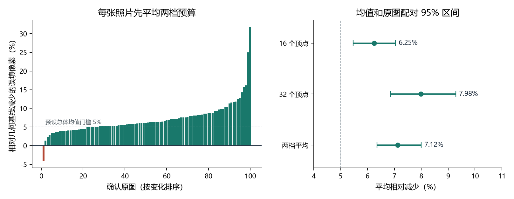
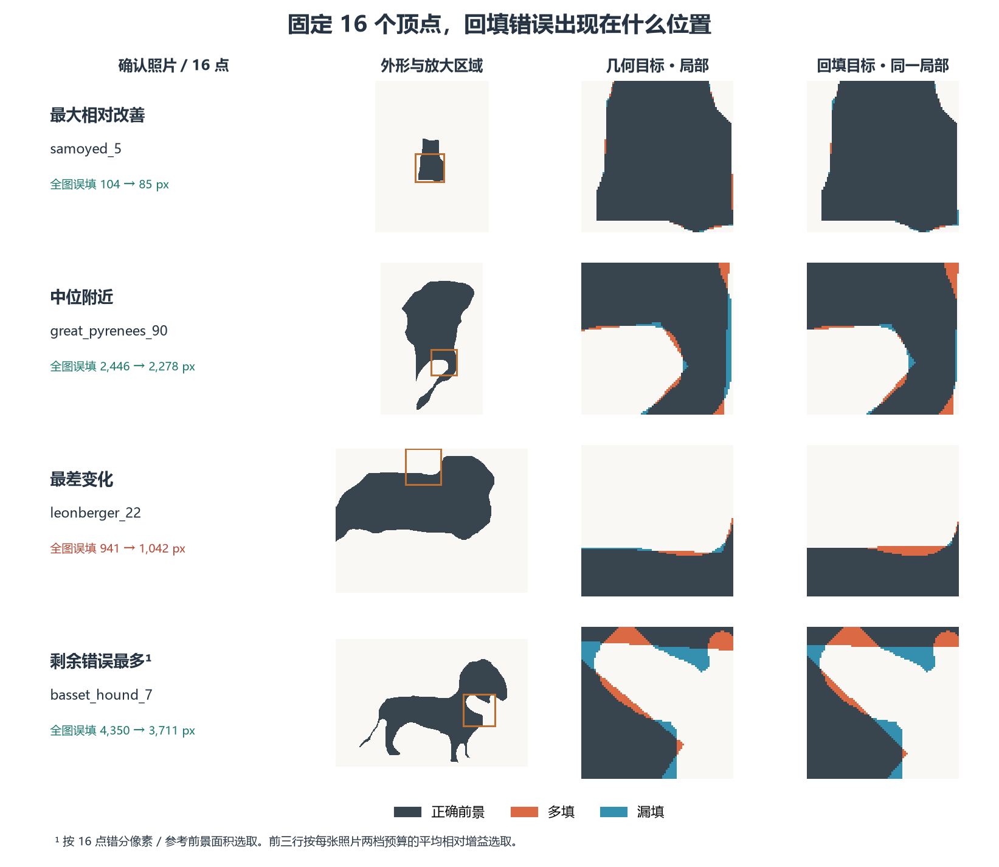

# 选题与独立确认

**建议题名为《固定顶点预算下基于回填误差的二值外轮廓多边形编码》。** 在给图片标注软件导出轮廓时，16 个点比几百个轮廓像素更容易传输和编辑。点连成直线后，一段弯边可能整段向内缩，或者把凹口封住。我们的做法是把每个候选位置真的画回原尺寸，哪一种少涂错像素，就把点放在哪里。用户接收的仍是完整的 16 或 32 个可移动顶点。已验证的是轮廓回填质量，人工编辑效率尚未测量。

## 为什么能这样改

同一条长边小幅向内或向外，可能影响许多像素。按各轮廓点到直线的垂距平方和优化，与整数端点在给定画法下的前景误填数并不相同。对二值蒙版，像素平方误差之和恰等于两张二值图的异或像素数，即 FP+FN。原蒙版在编码时本来就可读，六个编码器使用完全相同的输入。解码器看不到原蒙版。

先从原图像素提取最大的外轮廓。固定起点，按轮廓顺序在 8K 个均匀候选点和 RDP 候选点的并集中，用动态规划求 K 个顶点，使分段垂距平方和最小。然后逐个顶点在八个方向试探整数位移，步长依次为 8、4、2、1、4、2、1 个原像素。每次按实际 LINE_8 回填的 FP+FN 选择严格下降且保持简单多边形的移动。这个约束保证相对自身起点的异或误差单调不增。不同目标会走向不同局部解，因此与独立的几何细调比较仍可能退化。

POL1 格式用 10 字节保存标识、宽、高和 K，每个坐标对用 4 字节。各个方法的坐标精度、总字节数、分辨率及解码器一致。搜索采用确定性顺序。编码时间包含共同预处理、重新计算各方法自己的起点、搜索和写出内存字节，文件系统 I/O 单列在外。原生全轮廓 DP 以所有原始轮廓点做候选，是固定切点与规定误差下的强几何对照；定长 RDP 为传统对照。

## 开发与确认

开发集取官方 trainval 的 12 个品种、每种 3 张，共 36 张。12 张用于首轮参数筛选，分组关系保留在开发集合内部。独立确认组取官方 test 的另外 25 个品种、每种 4 张，共 100 张。全部是公开原图的真实 trimap 标注。哈希清单中无同字节样本，数据方未提供宠物个体与拍摄会话的身份。未使用裁片冒充独立样本。冻结提交在首次确认前已推送并通过远程标签核验。[冻结协议](../records/freeze.md) · [完整数据来源](../records/research.md)

| 独立确认的输出 | IoU | 平均错误像素 | 2 像素边界 F | 平均编码 ms |
|---|---:|---:|---:|---:|
| 原始外形无损 PNG | 1.00000 | 0 | 1.00000 | 4.55 |
| 定点数 RDP | 0.95765 | 1,742.01 | 0.80769 | 1.97 |
| 固定切点、限定网格 DP | 0.96868 | 1,272.14 | 0.86753 | 7.76 |
| 固定切点、全轮廓点 DP | 0.97074 | 1,184.86 | 0.88156 | 171.93 |
| 几何细调，7 次扫描 | 0.97609 | 957.04 | 0.92059 | 19.99 |
| 几何细调，15 次扫描 | 0.97601 | 960.90 | 0.92060 | 30.46 |
| 回填误差细调，7 次扫描 | **0.97773** | **894.31** | **0.92382** | **37.47** |

输入 PNG 保存标准化外形，平均 1,162.56 字节。每个有损算法在 16 点时严格为 74 字节、32 点时严格为 138 字节。每行先等权处理原图及两档预算。以照片为单位的相对改善与两行错误像素均值直接相除采用不同加权，主判定采用预先冻结的前者。

| 主要对照为 7 次扫描的几何细调 | 开发 36 张 | 确认 100 张 |
|---|---:|---:|
| 误填像素相对减少，图内先平均两档 | 6.76% | **7.12%** |
| 源图配对自助 95% 区间 | 6.04%–7.51% | **6.35%–7.99%** |
| 改善 / 退化图数 | 36 / 0 | **99 / 1** |

确认时 16 点和 32 点分别减少 6.25%（5.47%–7.04%）和 7.98%（6.85%–9.28%）的误填像素。两档平均每张减少 62.73 个错误像素（51.23–75.89），IoU 平均增加 0.1634 个百分点（0.1333–0.1972）。按品种整簇重抽得到主指标区间 6.30%–8.02%。两个预算是同张图上的重复观测；统计 n 为 100。冻结的 11 项判定全部通过。[逐图表](../results/confirm/per_image.csv) · [配对统计](../results/confirm/paired_summary.csv) · [判定文件](../results/confirm/decision.json)

## 消融、成本与边界

- 拿掉细调，只保留相同网格 DP，整体 IoU 为 0.96868。保留相同起点、候选方向和扫描次数，换回几何误差时为 0.97609。把几何搜索延长至 15 次扫描，平均 IoU 为 0.97601。所测改进可以归因于接受顶点移动的目标发生变化。
- 平均每次编码多花 17.48 ms。回填法在 16 点、32 点分别为 22.87、52.08 ms，混合两档 p95 为 60.25 ms。解码平均 0.103 ms。确认整次含全部基线及计算指标用 61.78 s，进程最高工作集 131.77 MiB。两种方法都可做离线导出，本方案的优势是相同文件大小下的质量。
- 边界 F 的总体均值略升，100 张里 48 张升、5 张持平、47 张降。32 点时，边界 F 从 0.99059 降至 0.98876。面积误差减少没有保证每条局部边界都更准。
- 目标定义为确定前景最大的外圈。44/100 张在取外圈与填孔时改变过原标签像素，最大改变 15,350 个。另保留针对原始全部标签 1 的事后描述性核算，几何与回填法的平均 IoU 分别为 0.91566、0.91713。需要保留孔洞和分离部件的场景必须另建多圈编码协议。[原标签敏感性逐图表](../results/confirm/scope_sensitivity.csv)
- 在 Abyssinian_75 的 32 点设置中，两种细调都从保证无自交的回退起点开始。预注册统计保留该图。去除该图的事后核查中，另外 99 张平均减少 7.03% 的误填像素。训练或优化不涉及随机种子；区间的随机种子已冻结。

## 案例

固定规则按两档平均相对变化选择原图，展示一律为 16 点。浅蓝表示漏填，橙色表示多填。同一行使用相同坐标；完整掩模和多边形可从审核包还原。

| 源图 | 为什么展示 | 16 点的实际结果 |
|---|---|---|
| samoyed_5 | 两档平均相对改善最大，31.86% | 错误像素从 104 降到 85，初始误差本来就小 |
| great_pyrenees_90 | 最接近中位 | 从 2,446 降至 2,278，主要减少漏填 |
| leonberger_22 | 唯一两档平均退化 | 16 点从 941 增至 1,042；32 点从 296 降至 289。两档平均相对多错 4.18%，IoU 平均下降 0.0723 个百分点 |
| basset_hound_7 | 16 点的残余错误占前景比例最高 | 从 4,350 降至 3,711，仍无法用 16 点贴合全部突出与凹陷 |

几何误差与像素误差均采用局部搜索。某次对回填目标有利的移动，可能限制后续顶点的选择；这能解释局部法存在反例，具体哪个移动造成 leonberger_22 最终差异尚未做逐步反事实验证。模型检测精度、不同回填器和用户编辑体验留待单独研究。
