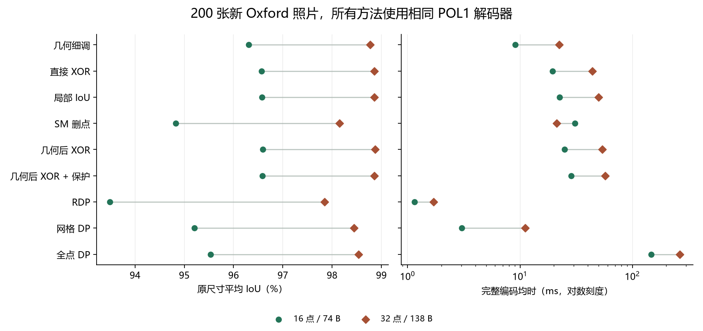
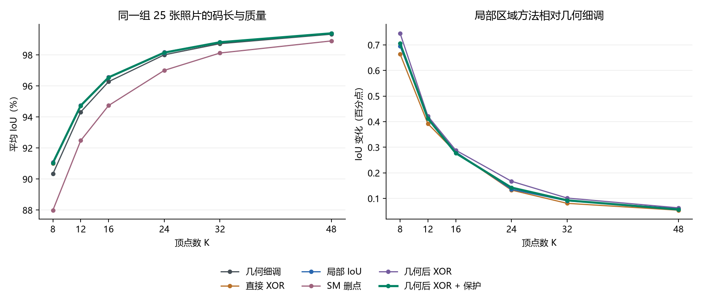
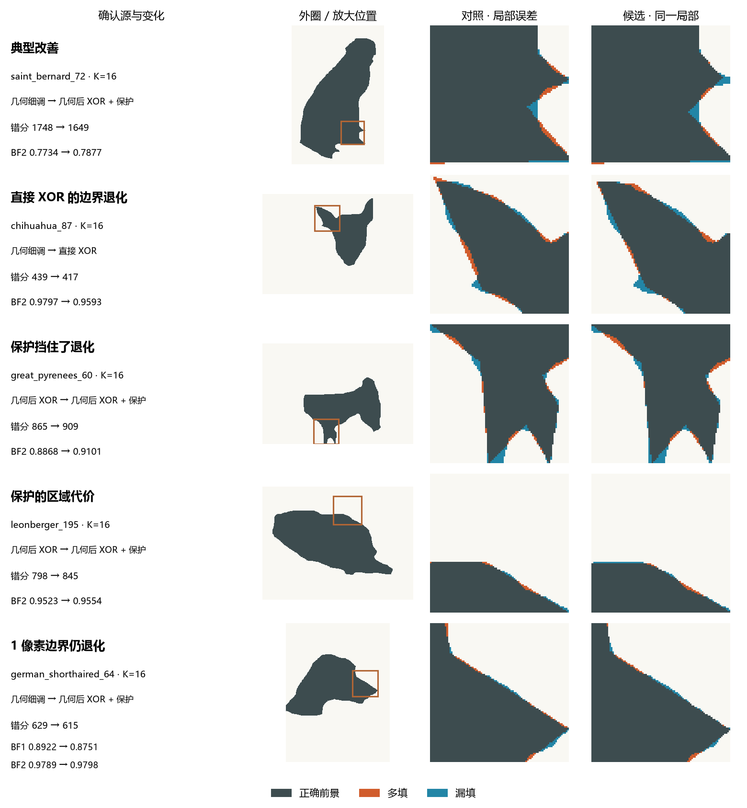

# POLY02 主控审核说明

**建议以“带逐图边界下限的固定顶点外轮廓导出”进入正式报告。** 实际用途是导出已有二值选区时继续减少多填与漏填，同时保证导出前那条几何轮廓在规定的两像素容差下仍然贴边。原 v1 对几何基线的收益可重复；新增的同搜索区域对照改变了对创新点的判断。

## 1　加入直接相关方法后，v1 还剩下什么优势

Panagiotakis 已直接研究固定点数、允许顶点离开原轮廓、最大化区域 IoU 的形状拟合，论文还提供 SM 区域删点基线。在新 Oxford 上，v1 的直接 XOR 比几何细调平均少错 6.86%，匹配起点、方向和扫描顺序的 local_iou 少错 6.94%。两种局部搜索都走出了轮廓上的初值，明显改善粗轮廓。v1 对只能从 50 个 RDP 点逐步删点的 SM 有 38.26% 的照片等权错分优势及 +1.2204 个 IoU 百分点。这个比较同时改变了起点和搜索空间，不能全归给损失函数。[直接相关工作与复现边界](../../records/poly02/research.md)

相同局部搜索下，v1 对 local_iou 的照片等权相对错分改善为 **−0.11%**（95% 配对区间 −0.29% 至 +0.05%），IoU 差为 **−0.0044 个百分点**（−0.0085 至 −0.0004）。两个区间均落在事前设定的实用等效范围。原方法相对几何目标的主要好处来自区域目标。直接 XOR 在本实现中计算代价较低，带预热开发计时的 16 点中位数为 20.09 ms，local_iou 为 23.00 ms；32 点为 45.30 和 52.33 ms。IoU 采用精确有理数比较，因此这些时间只代表本实现和本机。

## 2　为什么 XOR 和 IoU 很接近，输出却可能不同

设参考前景面积为 A。XOR 等于 FP+FN，IoU 等于 (A−FN)/(A+FP)。若当前 IoU 为 J，一个候选位置使 IoU 严格增加，当且仅当 ΔFN+J·ΔFP<0；XOR 的判据为 ΔFN+ΔFP<0。轮廓已经贴得较好时 J 接近 1，但两个准则处理并列及 FP/FN 交换的方式仍不同。400 组导出中只有 6 组的两个 POL1 完全同字节。以 16 点为例，直接 XOR 的平均 FP/FN 为 661.38 / 765.45，局部 IoU 为 699.95 / 727.98。质量均值相近不要求顶点相同。

## 3　从几何结果继续优化有什么用

主实验中每个方法独立执行完整编码，输出在 16 点均为 74 字节、32 点均为 138 字节。无保护的 post_xor 以已完成几何细调为起点，再做严格减小 XOR 的整数移动。它在 400/400 个图像预算上都少错。与几何起点相比，照片等权平均少错 **7.90%**（7.47%–8.35%），IoU 增 **0.1924 个百分点**。与直接从网格 DP 做 XOR 的 v1 相比，额外少错 **1.06%**（0.83%–1.28%），平均每次导出再省 7.17 个错误像素，完整编码多花 7.55 ms。这个顺序效应小于把几何目标换成区域目标的效应。

| Oxford 200 张、两档等权 | 平均错误像素 | IoU | BF2 | 完整编码均时 ms |
|---|---:|---:|---:|---:|
| 几何细调 | 1,006.27 | 0.97539 | 0.91608 | 15.72 |
| SM 区域删点 | 1,492.59 | 0.96491 | 0.84379 | 25.99 |
| 直接 XOR，v1 | 939.69 | 0.97712 | 0.92015 | 31.74 |
| 同搜索局部 IoU | 939.81 | 0.97716 | 0.92049 | 36.12 |
| 几何后 XOR，无保护 | 932.53 | 0.97732 | 0.92206 | 39.29 |
| 几何后 XOR，严格保护 | 936.44 | 0.97722 | 0.92404 | 42.82 |

[按 K 的 FP、FN、XOR、完整计时、各容差 F 与改善/持平/退化计数](metrics.md) · [配对不确定性与最差源图](../../results/poly02/new/paired_summary.csv)

## 4　边界保护的收益与价格

下限取每张图在同一 K 的初始几何 BF2。每个接受的移动都严格减少当前 XOR、保持简单多边形并满足该下限。从几何起点出发，**200 张照片平均少错 7.32%（6.88%–7.78%），每张平均少错 69.83 像素（60.15–80.32）**。无保护版本在 K16、K32 分别出现 70、95 次 BF2 退化；带保护后分别为 0、0。K16 有 179 张 BF2 提高、21 张持平，K32 有 87 张提高、113 张持平。与无保护版相较，守下限保留其区域收益的 **92.65%**，每次平均多错 **3.92 像素**、多用 **3.53 ms**。完整编码 p95 为 67.60 ms，低于冻结上限 150 ms。[冻结判定](../../results/poly02/new/decision.json) · [预热和重复计时](../../results/poly02/timing/summary.csv)

这里的逐例保证只覆盖 2 像素容差。严格保护相对几何起点的 BF1/BF2/BF3，两档合并平均分别提高 1.334 / 0.796 / 0.278 个百分点。但 K32 仍有 **109/200** 张 BF1 下降、**37/200** 张 BF3 下降。BF2 也只须保持在初始下限之上，允许从已达到的更高值小幅回落。对 local_iou，保护版平均 IoU 差为 +0.0063 个百分点（+0.0002 至 +0.0125），它对正式报告的价值主要是可解释的下限和代价。

## 5　外部形状和作者程序

作者数据包中 70 个 MPEG-7 类别各取一个真实二值形状，独立于 Oxford。保持作者 GIF 原尺寸，样本宽度 15–278、高度 11–210 像素。带保护版本相对几何初值平均少错 **16.92%（13.95%–20.13%）**；按形状平均两档，63 个改善、7 个持平。140 次导出均守住 BF2。它的平均 IoU 为 0.95697，local_iou 为 0.95759，差为 **−0.0626 个百分点（−0.1192 至 −0.0108）**。这个区间下限越过 Oxford 预设的 −0.10 个百分点非劣界限。跨域可以支持边界保证与相对几何起点的区域收益；外部数据上区域质量全面领先或等效的声明缺少证据。这里每类仅一张、两像素占图像的相对尺度不同。[外域全表](../../results/poly02/cross/paired_summary.csv)

作者 UPF-PSO 在 R2024a 原版函数上真实运行。选用开发轮廓复杂度的三个事前位置，对每张图在 K=8/16/32 各运行三个固定种子，不挑最好结果。下表先在种子内汇总，再等权处理三张图。原论文 K=3–10；16/32 是本轮扩展。表内质量来自实际 POL1 解码。

| K | 有效试验 | 作者 PSO 平均 IoU | 三图各自种子间 IoU 标准差范围 | PSO 完整编码均时 | 同三图 SM / local_iou / 保护版 IoU |
|---:|---:|---:|---:|---:|---|
| 8 | 9/9 | 0.87111 | 0.0056–0.0117 | 1.976 s | 0.8761 / 0.9022 / 0.9037 |
| 16 | 9/9 | 0.88898 | 0.0048–0.0456 | 1.952 s | 0.9352 / 0.9568 / 0.9572 |
| 32 | 9/9 | 0.88753 | 0.0061–0.0248 | 2.353 s | 0.9760 / 0.9857 / 0.9857 |

另用作者 Fish-a100 的 K4 完成输入输出检查。完整批次用时 103.03 s，含单次启动 41.08 s。每个编码时间包含 Python 标准化、同机 MATLAB 消息往返、作者求解、坐标转换与 POL1 生成；同表保存作者求解器内部时间与共同解码时间。在 27 次开发试验中有 12 次至少一个四舍五入后顶点越界，按已说明的共同格式裁回画布。全部转换为合法环。保留原生浮点点列与作者原生 IoU/Dice，二者与 POL1 指标单列。隔离目录另启 MATLAB 后，相同 28 项试验（含作者示例）的原生浮点坐标和 POL1 字节全部复现，计时独立重测。三个开发案例及高 K 的表现不代表作者在论文原始全域上的排名。[每次种子、质量与时间](../../results/poly02/pso/trials.csv) · [按源图统计波动](../../results/poly02/pso/by_source_seed.csv)

## 预算、形状标准化与复核

新 Oxford 的 25 张预定照片每张都跑同一批预算。保护版在 K=8/12/16/24/32/48 的平均 IoU 分别为 91.05%、94.74%、96.56%、98.15%、98.82%、99.40%，对应 POL1 大小 42/58/74/106/138/202 字节。曲线上的 K16/32 只取同一批 25 张。[质量曲线与数据](../../results/poly02/quality-by-k.csv)

200 张新照片中 69 张在最大外圈标准化时改变过前景像素，22 张含孔、49 张有多个原前景部件；MPEG 对应为 29、25、5 张。每行指明加入、移除像素数。新 Oxford 没有编码失败；网格 DP、几何、直接区域与后处理各有 3/400 次使用合法回退起点，RDP 和 SM 各有 8 次。回退仍计入计时与统计。全部逐图结果保留拒绝数、接受数和分域失败清单。主要相对改善先在每张图上计算再平均。若先合并所有像素，几何/无保护/保护版的 IoU 分别为 0.98143/0.98277/0.98270，大前景在该口径里权重更大。

开发最长轮廓有 1,558 个采样点。独立进程下 K32 全点 DP 编码 587.33 ms，进程峰值 108.31 MiB；候选网格 DP 为 20.63 ms、67.81 MiB。Windows 峰值工作集与结束 RSS 的实测字段分开记录；新 Oxford 整次比较含评分用时 172.27 s。完整内存记录保留最短、中位和最长开发轮廓，其他平台仅在支持峰值接口时标记峰值。[DP 实测](../../results/poly02/timing/dp_memory.csv)

## 五个案例和一个实际决定

- **典型改善**。saint_bernard_72，16 点，保护版将错分从 1,748 降到 1,649。
- **已有边界退化**。chihuahua_87，直接 XOR 少错 22 像素，但 BF2 从 0.97975 降到 0.95931。
- **约束有效**。great_pyrenees_60，无保护 BF2 为 0.88683，保护版为 0.91009，几何起点为 0.90520。
- **约束的区域代价**。leonberger_195，保护版比无保护多错 47 个像素。若应用只关心区域，这是守下限的损失。
- **保护不能转移到其他容差的反例**。german_shorthaired_64 的 BF2 从 0.97888 增至 0.97976，但 BF1 从 0.89221 降至 0.87506。主确认和外域均无实际违反已冻结 BF2 下限的案例。

演示保存了 great_pyrenees_60 的一次试探。第 13 个点从 (274,166) 移到 (273,167)，错分将从 937 降为 922，但 BF2 将落到 0.904402，低于 0.905201 的下限，因此保留原位置。另一个移动把错分从 923 降到 914，候选 BF2 为 0.905681，获接受。两次移动前后的 POL1、实际解码计数和局部图均可复算。[离线演示](../../results/poly02/demo/demo.html) · [移动记录](../../results/poly02/demo/witness.json)

**正式报告的贡献定位。** 在严格固定码长、现成几何外圈和特定整数回填器的条件下，用单个可解释的边界约束换取可量化的质量保证；同时用同搜索换目标解释 v1 主要收益。全局最优、优于所有区域方法、多部件或孔洞完整保真、人工编辑省时均未由本轮验证。作者 PSO 未扩至全确认集，LEMS 没有另跑，跨域结论仅指上述 70 个 MPEG 形状。本轮交付在可复核研究阶段结束。