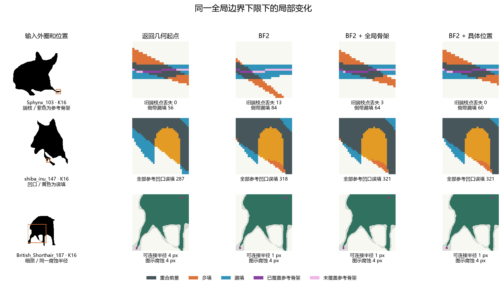

# BF2 守住后，哪里仍会失真

**决定：保留共同诊断及可选的位置保护，降级为非主线。** 在已知 36 张 Oxford 开发照片上，全局 BF2 可以守住，同时丢掉原本已覆盖的一小段末梢。具体位置约束确实修复了这种错误，且没有把搜索变为零动作。但相对更简单的全局骨架召回下限，额外的未门控质量收益集中在少数图片，细颈和凹口问题仍然存在。该小试独立于完整蒙版的多圈编码。

## 输入定义与普通真实样本上的问题

只使用 POLY02 指定的 36 张 trainval 开发蒙版，每图 K16/32 两档。目标沿用 POLY02 的最大外圈，几何细调输出作为起点。原图携带的其他部件和孔在完整蒙版主线另行处理。所有端枝、凹口、厚区锚点、走廊和网格都从源外圈定义，再读取搜索结果。每个比例标明分母，同一源的两个预算不增加独立样本量。[诊断登记](../../records/poly03/detail-protocol.md) · [逐结构与逐位置范围](../../results/poly03/detail/features.csv)

| 诊断对象 | 合格原图 | BF2 版相对几何起点的具体变化 |
|---|---:|---|
| 参考骨架端枝 | 22/36 | 3 张、3 个品种丢失达到连续长度规则的旧覆盖端枝段；K16 两例、K32 一例。最长连续 13 像素 |
| 参考凹口 | 9/36 | 3 张、4 个图像预算出现单个凹口团块至少净增 4 个误填像素 |
| 两个厚区之间的细颈 | 8/36 | 4 张、5 个预算的可连接腐蚀半径下降。未观察到两锚仍在而原参考走廊断开，也没有锚点被覆盖后再丢失 |
| 固定 4×4 局部边界格 | 36/36 | 26/36 张、31/72 个预算出现某格净少匹配至少 3 个参考边界像素，同一张全局 BF2 仍达到起点 |
| 同一离散图像最近邻放大 2 倍 | 36/36 | 固定 2 像素容差时，19 张、22/72 档出现 BF2 比放大后的几何起点低；按倍率放宽至 4 像素时仍有 7 张、7 档略低。取样与边界定义离散，放大后不承诺完全同分 |

薄端枝由端点连续追踪和输入距离变换确定。另报整张参考骨架上的连续失覆盖长度，采用分量内双次广度优先搜索，遇环时是图直径的下界。最小有意义丢失长度为 max(3,ceil(0.0125√A))，A 为参考前景面积。细颈半径是两输入锚点在预测与参考共同支持的固定走廊中，仍能保持 8 连通的最大整数腐蚀半径。单像素损失、局部格得分和 BF1 下降均未直接充作断枝证据。一个双厚区夹具在桥被切断后得到走廊断开，独立复核记录保留。[逐图诊断](../../results/poly03/detail/per_image.csv) · [各探针合格和触发数](../../results/poly03/detail/diagnosis.json)

## 位置约束是否有额外价值

一组比较只加骨架门控，另一组同时守住原始几何 BF2。全局骨架规则要求参考骨架被覆盖点的总数不低于起点。具体位置规则检查起点已经覆盖的每个参考骨架坐标。每个方法独立运行完整几何初始化，七轮候选方向、顺序、严格降低 XOR 的规则和 POL1 一致。编码时只算本方法需要的特征。评估用的端枝、侧带、凹口和细颈没有进入接受判据。

| 方法 | 相对起点平均少错 | BF2 低于起点 /72 | 原已覆盖骨架位置丢失总数 | 未门控侧带漏填总数 | 零后处理动作 /72 | 完整编码平均 ms |
|---|---:|---:|---:|---:|---:|---:|
| 返回几何起点 | 0 | 0 | 0 | 924 | 72 | 17.12 |
| 无保护区域优化 | 7.43% | 32 | 131 | 1,007 | 0 | 40.48 |
| POLY02 的 BF2 | 6.73% | 0 | 115 | 974 | 0 | 44.26 |
| 仅全局骨架召回 | 6.98% | 31 | 32 | 885 | 0 | 127.75 |
| 仅具体骨架位置 | 6.83% | 31 | 0 | 864 | 0 | 128.11 |
| BF2 + 全局骨架召回 | 6.33% | 0 | 38 | 880 | 0 | 140.85 |
| BF2 + 具体骨架位置 | 6.18% | 0 | 0 | 865 | 0 | 142.29 |

错分降幅逐照片、逐预算先相对各自几何起点计算，两档在每张照片内等权。计数总数按实际的 72 个图像预算列出，同一位置在两个预算分别评价。侧带为输入端枝经欧氏圆盘半径 2 膨胀后、属于前景且排除**全部骨架像素**的区域。36 张的源图级配对自助区间采用 10,000 次重抽。[逐 K 汇总与实际耗时](../../results/poly03/detail/summary.csv) · [原图级配对统计](../../results/poly03/detail/source_paired.csv) · [504 份独立解码分数和字节](../../results/poly03/detail/decoded.csv)

对 BF2 加具体位置后，未门控侧带每个图像预算平均少漏 1.51 个像素（按源配对 95% 区间 0.69–2.46），同时全图平均多错 11.14 个像素（5.43–18.31）。和同样保 BF2 的全局骨架规则相比，侧带平均只少漏 0.21 个（少漏的 95% 区间 −0.03 至 0.56），36 张按源平均后 4 张改善、31 张持平、1 张退化。72 档中有 61 份 POL1 与全局规则完全相同。位置规则多出的硬保证可以有用途，但连续末梢丢失只在普通开发源中出现 3 张。不能凭门控位置零损失就把该变体列为普遍质量提升。

具体位置规则没有防止侧带每一个像素被舍弃：72 档仍有 44 次原先覆盖的侧带像素失覆盖，亦有 103 次新覆盖。它也没有修复负空间或大多数连接宽度变化；与 BF2 组相比，可连接半径降低的仍是同样 5 档。全图扫描细化的初始化是当前实现的主要成本，含 BF2 的两种骨架方案每次骨架及门槛初始化平均约 97 ms。实际总时间已含候选、排序、合法性和全图回填。不同组测于同机开发负载，几毫秒差异不作为速度结论。



- **具体位置确有作用。** Sphynx_103、K16。BF2 从几何起点的 0.71453 增至 0.75603，仍连续丢失 13 个旧端枝点。全局组可用新覆盖的 3 个骨架点抵消丢失的 3 个；位置组守住这 3 个旧位置。侧带漏填由 BF2 版的 84 降为全局版 64、位置版 60，几何起点为 56。全图错分相应为 1,979、2,122、2,149。可看见局部救回和全图代价同时存在。
- **未解的凹口。** shiba_inu_147、K16。输入定义的凹口背景中，几何起点错填 287 个，BF2 版错填 318 个，两种叠加骨架版均错填 321 个。保护前景中心线无法要求留出这些背景像素。
- **宽度损失与断开分开记录。** British_Shorthair_187、K16。两个源厚区锚点之间，起点共同走廊可在腐蚀半径 4 像素时连接，三个后处理版本均只到 1 像素。原分辨率上两锚能连接。图中第三行统一显示腐蚀 4 像素后的走廊。

上述图片按最长旧端枝连续损失、凹口净退化和可连半径最大降幅取例。完整位置、裁切和每方法指标在 [案例清单](../../results/poly03/detail/examples.csv)。结论属于已知资料上的诊断型开发研究。若未来应用已事先指定需要守住的笔画或末梢，可在另一批盲留出的对应结构上专门验证位置约束、非门控侧带误差和运行成本；本轮不将它拼入多圈主线。[三项直接先例及差异](../../records/poly03/detail-literature.md)

## 复算

在项目根目录运行。现有 POLY02 数据缓存可直接使用；新检出可先用原公开 19 MB Oxford 标注包恢复 36 张开发图。旧多边形缓存缺失时，按原版本从输入重新生成并核对既有逐图 SHA-256。两份小型 polygons.zip 含本轮真实编码，无须从复杂图中反推顶点。

```powershell
python -X utf8 scripts/prepare_data.py --check
python -X utf8 -m poly03.detail_analysis --verify-only
python -X utf8 -m poly03.detail_probe --out local/poly03/detail-replay
python -X utf8 -m poly03.detail_guard --out local/poly03/detail-replay
python -X utf8 -m poly03.detail_guard --standalone --out local/poly03/detail-replay
python -X utf8 -m poly03.detail_analysis --folder local/poly03/detail-replay
```

--verify-only 可独立、只读地复核已发布 504 份 POL1，再次编码七项真实案例，使用 SciPy 膨胀和距离变换/连通分量另算非门控侧带、细颈结果。后四条在另一目录重建所有源表、图件与全套试验。依赖沿用 POLY02，含 NumPy、SciPy、OpenCV、Pillow 与 Matplotlib。程序未读取新确认源。本轮未测试医学管状结构、跨数据域可迁移性或全部真实动物细节。
