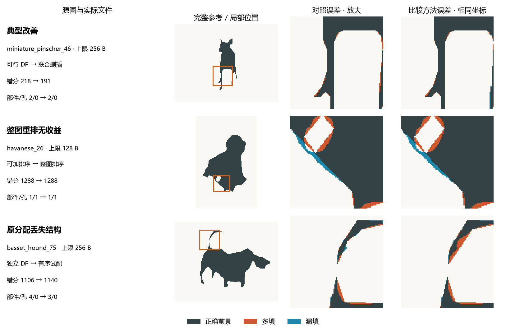
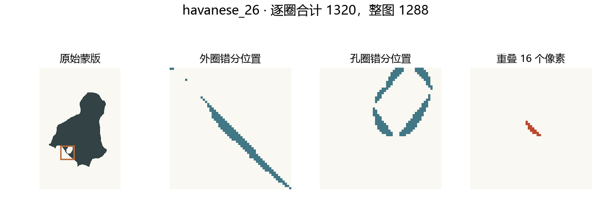
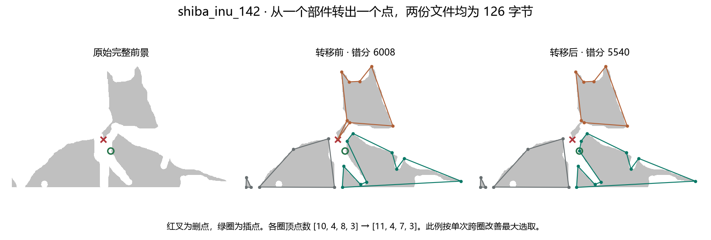

# POLY03-EXPLORE 主控交接

**建议继续的题目为《总字节预算下保持部件与孔对应的二值蒙版编码与跨圈顶点重分配》。** POLY02 仍是已通过独立确认的成果。本轮只给出开发结论，未开放新的确认集。

**旧方法卡在什么地方。** 单圈导出先取最大外圈并填孔。其 BF2 下限再可靠，也无法替已经丢弃的部件或孔分配一个顶点。推广到完整蒙版时，面积误差最低的分配也可能多出一个部件。

**新机制怎样处理。** 每一圈有父编号，全部元数据与坐标共同消耗预算。用同一个逐圈近似器构造误差曲线，先在预算里分点，重画后核对每个部件、孔及其对应关系；必要时试下一个分配。随后可从某个位置取一个点，补到同圈或另一圈的实测高误差边段，每个获准的操作都重画实际完整蒙版。

**相同资源下的收益有多大。** 在 256 字节上限、同一时刻实际已经完成的文件中，允许跨圈的可加预排比只在圈内搜索平均少错约 6–8 像素。跨圈有条件地增加搜索空间，绝对效果较小。更昂贵的逐候选整图排序没有提供新的质量优势。

**被否定的假设。** 并非多圈就有显著区域误差耦合。合法分配间的 28,609 对比较里，整图与可加误差的排名完全一致。Oxford 成熟单圈也没有因增加一次删插而普遍受益。固定点数、拆分/合并、总预算 DP、拓扑保持和区域保真都有直接先例。[查新及替代解释表](../../records/poly03/related.md)

## 一　完整蒙版与真实码长

选样覆盖简单轮廓、有限孔、分离部件、近接边界四层，每层 8 张，共 26 张 Oxford 与 6 张 MPEG。可见候选池及分层只依据输入形成，包含 48 个近接、20 个孔、40 个多部件、198 个简单源。从各层按确定哈希取样，数据分布不足时按同层剩余顺序补满。所有源均来自过去已使用的研究材料，旧确认图在本包中只作已知开发图。三个主预算为 128、256、512 字节，共 96 组；仅有两张至少八圈的复杂输入另测 1024 字节，总共 98 个图像预算设置。

PM31 长度为 10+4R+4V 字节，包含宽、高、R 个环的父编号/计数以及 V 个整数顶点。分配比较要求同一输入的成功文件逐字节数相等。256 档多数为 254 字节，一张已能精确回填的源只需 210 字节。前景 8 连通、背景 4 连通，连续矢量环的包含树、数字部件/有限孔的双向交集匹配和前景—背景区域邻接图都要通过。高精度表示逐像素回填通过全部 512 个 3×3 二值图、专门夹具和 32 张实图。[格式、点接触与不支持范围](format.md) · [原始清单](../../records/poly03/full-sources.csv)

| 方法 | 128 B 成功 /32 | 256 B 成功 /32 | 512 B 成功 /32 | 1024 B 成功 /2 | 合计 /98 |
|---|---:|---:|---:|---:|---:|
| 周长分配 | 25 | 29 | 30 | 1 | 85 |
| 独立误差 DP 第一解 | 27 | 29 | 31 | 2 | 89 |
| 可加顺序试配至结构合法 | 30 | 30 | 31 | 2 | 93 |
| 整图排序选可行分配 | 30 | 30 | 31 | 2 | 93 |
| CGAL squared，第一次 | 26 | 30 | 30 | 2 | 88 |
| CGAL scaled，第一次 | 27 | 29 | 31 | 2 | 89 |
| 从可行起点做联合删插 | 30 | 30 | 31 | 2 | 93 |

3 个设置低于“每个原环至少三点”的格式下界；没有真实源被判为不支持。两张复杂图在另两个预算上仍未找到合法输出：pocket-14 有 2 个部件、26 个孔，512 字节超过 458 字节下界，却仍未找到可行解；turtle-3 在 256 字节同样未找到。二者在 1024 字节均有合格文件。失败逐项进入分母，未给缺失文件填零失真。一次普通开发源 basset_hound_75 的独立 DP 在 254 字节下错分 1,106 个像素，却把 3 个部件变成 4 个。换一个分配仍占 254 字节，错分变为 1,140，恢复为 3 个正确对应的部件。这解释了为什么最终必须重新验收结构。

## 二　哪些收益来自分配，哪些来自实际移动

每圈首先用定点数 RDP 的嵌套层级给出候选。两种分配使用同一套环近似，可加 DP 对该候选族准确求解固定总点数下的最小逐圈 XOR。它不是所有可能整数多边形的最优解。周长法单独按周长分配并保留各圈最低点数。两者在三个主预算共同成功的 30 个源上，按源先平均预算，DP 比周长少错 69.42 个像素（开发配对 95% 区间 39.79–105.75），IoU 增 0.1931 个百分点。

把第 i 圈的独立错分图写为 Eᵢ，整图错分是各 Eᵢ 的奇偶叠加。若某像素被 m 个环算错，逐圈和在该点记 m，整图只记 m mod 2。首轮共计算 **2,132** 个分配候选，35 个候选的两种误差不同；所有候选的 34,587 对比较有 5 对严格倒序。排除结构不合法候选后，**1,869** 个候选中仅 1 个存在误差抵消，28,609 对排名的严格倒序与并列拆分均为 0。这个非加性候选位于 havanese_26，两个环的错分区重叠 16 像素，逐圈合计 1,320，整图为 1,288。**误差可以不同，但不一定会改变选择。** 可行池最小逐圈误差解与最小整图误差解在 93 个可行设置中逐字节相同。[逐候选原始表](../../results/poly03/full/allocation_candidates.csv) · [逐源排名计数](../../results/poly03/full/coupling_by_source.csv)

独立 DP 的 95 个不低于下界的设置中有 6 个不合法，按表中实测口径为 6.32%。5 个的首要拒绝原因为数字计数改变，1 个的首要原因为连续环边界相触。可加排序后的结构试配恢复了其中 4 个。进一步把“全图无效环的定位”作为待检验的附加机制，在上限 64 次真实结构检查下比较了按可加误差精确枚举次优分配、将单圈置于其余高精度圈中定位异常，以及四种固定循环起点的简单替代。三者均只恢复 4/6。精确依序方法对四个成功例的检查数为 2、3、14、5 次，定位策略分别为 5、9、22、16 次，且输出相同。**保留有序试配，淘汰额外的逐圈故障定位策略**。其余两例只能标记为当前搜索未找到。[可行性对照](../../results/poly03/feasibility/per_image.csv) · [循环起点对照](../../results/poly03/phase/per_image.csv)

删插比较从同一合法的可加分配起步。单独删除和插入的估计只决定提案顺序，最终移动按整张真实解码图检查。固定两轮，每轮最多 24 个联合候选。三个主预算中，删插比共同起点平均每个源少错 **113.01 个像素**（81.94–147.69），IoU 增 **0.4249** 个百分点，未参与选择的 BF2 增 **0.8989** 个百分点（0.5492–1.2401）。这组比较包含额外搜索。若同轮数允许同圈删插作为强对照，再放开跨圈只额外少错 **9.30 个像素**（0.87–20.75），IoU 增 **0.0233** 个百分点。31 个共同可行源中，分别有 14 个改善、16 个持平、1 个退化。所有可行设置的 173 次获准移动仅 38 次跨圈，分布在 15 个源、28 个图像预算中。两轮策略会改变搜索路径，不保证逐图胜过只做圈内移动。

## 三　同一真实时间内能拿到什么

最初参考实现为了诊断同时计算两种目标，相关 time_full 数据保留，但不用于单纯整图方法的速度结论。随后单独测量四种正常路径：只算整图、复用未改圈再算精确整图、可加预排后整图验收、只准圈内的可加预排。每个变动环都在完整四倍画布重新光栅化。两条完整画布复用路径分别核实 4,248 个候选的逐圈分数或整幅像素，173 步接受路径与 93 份最终文件均与各自慢速基准一致。没有使用小 ROI 裁片冒充全图。[轨迹核对](../../results/poly03/time_fair/trace_check.json)

在全部 32 张图的 256 字节预算上，每源每法实际从原始输入运行 3 次，方法顺序打散。于 100/200 ms 分别取到时已完成序列化的最近合法输出。单位仍是源图，重复先在源内平均。30 张均可交付，另 1 张低于下界，1 张未找到共同起点。允许跨圈的可加预排相对只准圈内的同算法，在 100 ms 平均再少错 **6.22 像素**（2.47–10.81），在 200 ms 再少错 **8.17 像素**（0.91–16.70）；对应 IoU 增 **0.0163 / 0.0237 个百分点**。非门控 BF2 差分别为 +0.1113、+0.1477 个百分点，后一项区间含零。与使用完整画布缓存的精确整图排序相比，可加预排在两时点还分别少错 **4.62 / 3.28 像素**。在同提案数下结果相同，在同可用时间下更便宜的排序往往能做更多工作。这个量级和本机、候选生成成本、计时噪声有关，不能外推成明显的人眼或编辑效率提升。[可用文件与完整实耗](../../results/poly03/time_fair/per_image.csv) · [同时间配对区间](../../results/poly03/time_fair/paired_summary.csv)

## 四　强基线和跨进程差异

在首次真实运行中，官方 CGAL squared 与删插法于三个主预算共同成功的 86 个设置、30 个源上，后者 IoU 平均高 **0.6363 个百分点**；第二次进程的相同口径为 **0.6241 个百分点**（85 个共同成功设置）。CGAL squared 通常更快，不能将相同字节下的质量优势解释为同等编码成本的全面优势。CGAL scaled 在这些像素轮廓上更倾向维持间距，实测区域误差较大。

完整复跑保留了两个 CGAL 原版实现的全部实际输出：同一输入和预算的 squared 有 41/95、scaled 有 44/95 个有候选设置得到不同字节，其中 squared 有 1 次数字结构通过状态翻转，成功数从 88/98 到 87/98。其他八个方法的状态、字节、候选分数和删插轨迹均复现。CGAL 5.4 的等代价堆没有坐标次级排序，约束枚举又受指针排序影响。固定 RNG 仍可打破平局走向不同。单独给完全相同的代价增加坐标次序的适配，是机制敏感性对照。对 190 个有原生候选的源/预算/代价组合，两个种子各重复三次，全部 1,140 次中每一组合的轨迹和文件均稳定。含另两个 1024 字节档时，删插相对 squared 原版首轮、原版复跑和稳定适配的共同成功源级相对错分改善分别是 24.03%、23.79%、24.09%，没有因适配而反转。适配不能替代官方原版原始表。[平局控制逐组比较](../../results/poly03/cgal_variation/exchange-comparison.csv) · [稳定适配真实文件](../../results/poly03/cgal_variation/encoded.zip)。连续平面保证与光栅数字对应分别核查。[原版构建与重复敏感性](cgal.md) · [逐方法重复记录](../../results/poly03/repetition/summary.csv) · [按 K 和结构分层的完整表](full-tables.md)

## 五　单圈与细部方向的去留

**单圈原子删插有真实逃逸见证，淘汰其作为常规后处理的假设。** 在 36 张 Oxford 开发照片、K16/32 的等评分上限下，随机、几何和回填排序删插均未降低错分；继续单点与三起点分别平均少错 2.39、3.44 像素。单独的等时对照结论相同。对已认证停滞的 Bengal_148 进一步完整评估 1,244,760 个联合候选，最好的尝试从 72 错增至 74 错。反过来，从既有 MPEG 库按输入复杂度分位先选的 10 个形状、20 个停滞状态中，7 个可改善，共 6 个源。device5-9 / K16 的单点邻域已经完整扫描，原来错 824 像素，单删会错 825，完成删插后错 786，16 点两端同为 74 字节。联合 BF2 为 0.8134，高于原几何下限 0.7700。它证明有些形状能逃离这组步长和方向的单点停滞，尚不能证明外域回填排序在同时间下优于随机或几何排序。[全部单圈方法与负结果](single.md) · [真实移动图](../../results/poly03/single/mpeg/device5-move.png)

**保留细部诊断，具体骨架位置保护降级为可选。** 输入规则认定的 22 张有合格端枝的照片中，3 张在 BF2 已守住时丢掉原本覆盖的一段端枝。8 张有可测细颈者中 4 张变薄，未观测到参考走廊在原尺寸真正断开。具体位置门控把 BF2 方法丢失的 115 个旧骨架位置降到 0，72 个图像预算全部有移动。相对更简单的全局骨架召回下限，61/72 个文件相同，未用于门控的侧带漏填平均只再少 0.21 像素，配对区间含零；细颈与凹口均有未解决的反例。该诊断沿用单圈 POL1，不与多圈 PM31 混算。[七组消融与尺度诊断](details.md)

## 主控决定

1. **继续作为待确认主线**：完整原始蒙版的真实字节预算、部件和孔的身份验收，以及可加预排、容许跨圈、最终按完整解码严格接受的顶点转移。在目前开发分布下，相对仅圈内搜索有小幅同资源增量。
2. **保留为基线和工具**：逐圈 DP 加简单有序试配、原版 CGAL 两种代价、POLY02 稳定单圈、单圈删插与局部细部诊断。独立 DP 固定候选曲线，结论不代表超越所有多对象 DP 或通用图像压缩器。
3. **淘汰或降级**：普遍而显著的全图排序耦合、额外的高精度上下文故障定位、成熟单圈上的例行删插，以及将逐点骨架保护强制并入主线。
4. **尚待验证**：更多独立结构丰富源、不同 CPU 时间政策、稀有合法耦合、剩余不可行设置和人工编辑价值。没有运行 POLY03 新确认集，也没有撰写最终 Word。[下一阶段确认设计](../../records/poly03/next-confirmation.md) · [启动与离线复算](README.md)
