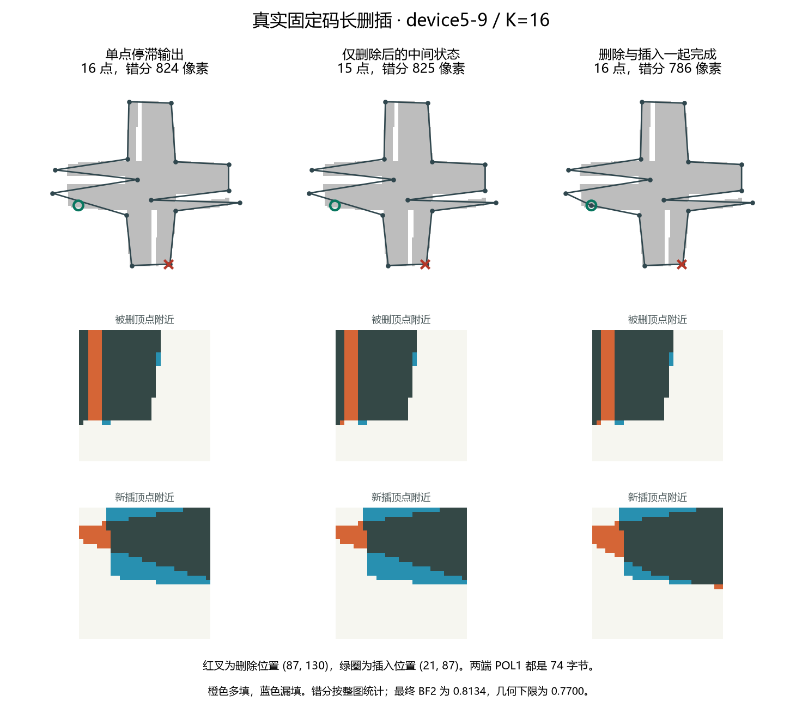

# 单圈研究结论

**在已用 Oxford 开发图上淘汰单圈删插作为常规后处理。** POLY02 保护版已经把有限顶点放在代价很高的位置。增加一个点能补回的像素通常远少于拿走一个点造成的损失。更长的单点搜索或从扰动起点继续单点搜索，在同一资源上限下反而产生小幅改善。已见 MPEG 形状中，少数结构能靠一次删插逃离单点邻域的真实停滞；这一点足以保留通用原子操作，尚不足以作为跨形状的质量或效率主张。

## 对照与计费

Oxford 使用 POLY02 已用的全部 36 张开发照片、原尺寸单圈外形、K16 和 K32。每次实际重跑几何起点和 POLY02 保护版，并与旧逐图 SHA 检查。下限始终取原几何起点的 BF2，所有最终输出使用同一 POL1 格式，每个文件 74 或 138 字节。同圈删除一个顶点并向一条不相邻的原边插点，每个联合候选都从完整顶点序列在原生画布回填。排序时才使用单独删点、单独插点的成本。面积统计使用 FP+FN。

三种原子引导共享同一位置池。每条边分成四个投影区间，从所属参考边界像素中取每区间距边最远的位置。区域排序按各自完整画布的 K−1 及 K+1 试探得分，几何排序按关联点到有限线段的平方距离改变量，随机顺序从同一池均匀打散。其余对照为继续八方向单点坐标下降，以及保留原 incumbent、另从轻微扰动的可行环继续搜索的三起点法。随机删插和多起点各跑三个固定种子，先在源图与预算内平均种子，再在照片内等权平均两档。人工编辑效果未测。

等评价数实验为每个源图、每个 K 提供 64K 次额外完整回填算 XOR 的上限。区域排序自己的中间态计算也占配额。独立等时实验取每个开发品种预定的一张图，共 12 张，K16/32 的额外墙钟上限分别为 120/220 毫秒；所有方法可在找不到更多候选时提前结束。下表给出实耗时。编码时间包含提取输入、网格 DP、几何和区域初始化、候选生成与排序、最终候选回填、合法性与 BF2 检查及实际内存序列化。另附完整初始/增量目标评价数、BF 检查数、计时和每个文件的 SHA。主流程没有采用 ROI 回填。

| 方法 | 等评价 36 图，平均少错像素 | 平均额外 XOR 评分 | 完整均时 ms | 等时 12 图，平均少错像素 | 完整均时 ms |
|---|---:|---:|---:|---:|---:|
| 原样保留 | 0.00 | 0 | 53.28 | 0.00 | 50.37 |
| 继续单点 | 2.39 | 957 | 73.62 | 4.63 | 72.06 |
| 三起点单点，三种子平均 | 3.44 | 1,536 | 89.73 | 7.54 | 133.52 |
| 随机删插，三种子平均 | 0.00 | 1,471 | 98.69 | 0.00 | 114.50 |
| 几何误差排序删插 | 0.00 | 1,471 | 103.19 | 0.00 | 120.85 |
| 回填误差排序删插 | 0.00 | 1,511 | 99.75 | 0.00 | 120.69 |

等评价数下，继续单点的源图配对自助 95% 区间为少错 1.25–3.86 像素，21/36 张改善，其余持平。三起点区间为 2.16–5.16 像素，32/36 张改善。继续单点平均 IoU 增 0.0064 个百分点，BF1 增 0.065 个百分点，BF3 变动 −0.035 个百分点。三种原子引导在这组起点上连一个严格减少 XOR 的最终候选都未选出，因此非门控指标也原样保持。等时比较中，继续单点的平均额外搜索时间 21.35 ms，区域排序 70.39 ms。实际时间与许可上限分列，当前机器同时承担其他项目工作，毫秒差异仅作实测成本。本轮两项预算比较都未支持区域排序有独立优势。[各预算汇总](../../results/poly03/single/summary.csv) · [配对区间](../../results/poly03/single/paired_summary.csv) · [等评价逐图](../../results/poly03/single/quota/per_image.csv) · [等时逐图](../../results/poly03/single/time/per_image.csv)

## 为什么 Oxford 的删插没有收益

先在每个开发品种预选一张图，从共同保护版继续轮流扫描半径 1、2、4、8 的全部八方向单点移动，直到完整周期无接受。预选 12 图的 24 个状态都完成停止认证。第一次交换试验无改善后，按单独登记的规则扩大坐标。对成本最低的至多六个供点、原误差像素归属最多的至多六条边，枚举全部所属原轮廓点、它们与弦投影之间的半程点、弦上七个位置的双侧法向格点。预登记的 12 张仍无改善，于是对其余 24 张完成同样诊断。全部 72 个点数状态获得完整无改善周期，累计 568,888 个真正联合回填候选。没有一个候选降低当前 XOR，BF2 尚未成为这些提议的拦截原因。有限池之外的位置仍可能不同。

| K | 每张最便宜的删点代价，中位数 | 每张最佳独立插入收益，中位数 | 每张最小实际联合增错，中位数 | 联合提议数 |
|---:|---:|---:|---:|---:|
| 16 | 217 | 31.5 | 183 | 317,585 |
| 32 | 42.5 | 9.5 | 32.5 | 251,303 |

两个预算下各 36/36 张的独立最便宜删除均比最佳插入收益大；结论另经真正的联合得分逐一核对。取 K32 删除代价最低的 Bengal_148，更强诊断覆盖全部 32 个供点、30 条非相邻原边，允许每条受点边使用整条输入轮廓上的坐标，再补半程和法向格点。1,244,760 个完整回填中最低仍为 74 个错分。起点错 72 个像素，删单独为 77，插单独为 69，联合为 74。这个最低分提议合法、BF2 仍为 1，因此真正的输出保留原顶点。其停止证书列出全部 1,024 个方向和步长试探，950 个落在图内，均未产生合格改善。另有解析正控制，源形状的单删会从 29 错变成 34 错，但联合操作把错分降到 5，验证实现确实可以接受这种动作。[72 个环的成本分解](../../results/poly03/single/cost_audit/isolated_vs_joint.csv) · [真实负例与完整顶点](../../results/poly03/single/cost_audit/real_case.json) · [全供点和受点边的实际最低误差](../../results/poly03/single/cost_audit/all_donor_edge_scores.csv) · [单点停止证书](../../results/poly03/single/cost_audit/single_move_certificate.csv)

## 已见 MPEG 中的局部停滞逃离

在读这批图之前登记复杂度排序，按原外圈闭合链长平方除以填充前景面积，从 POLY02 已看过的 70 个不同类别取十个等距顺位中点。十张各测 K16/32，全部达到同样的完整单点停止条件。复用上述六供点六受边的宽位置池，共真实回填 83,389 个联合候选。在 7/20 个状态、6/10 个源形状上能严格少错。两个状态原误差已为零。以源形状为统计单位，先平均两档，平均少错 2.55 像素（描述性 95% 区间 0.30–6.65），按形状等权的相对减少为 3.78%（1.49%–6.23%）。两档合计少错 51 像素，其中 41 来自同一张 device5-9。该补充提供有限邻域的存在性证据；未做宽池与各替代排序的外域等时结论。[70 个输入排名与选样](../../results/poly03/single/mpeg/input_ranking.csv) · [20 个逐图预算](../../results/poly03/single/mpeg/per_image.csv) · [全部七个联合操作](../../results/poly03/single/mpeg/winners.csv)

- 首个可复核实例为 Bone-7 / K32。停滞时 15 个错分，去掉原点 (12,106) 后仍为 15，将新点 (28,47) 加在受点边后降至 12，BF2 保持 1，前后均为 138 字节。独立全扫 1,024 个槽位，102 个越界、78 个非简单、844 个未严格减错，0 个合格单点邻居。[真实顶点与坐标](../../results/poly03/single/mpeg/witness.json) · [独立停止证书](../../results/poly03/single/mpeg/escape_point_certificate.csv)
- 最大改善同时满足“中间单删变坏”。device5-9 / K16 的 POLY02 保护起点为 975 错，继续单点到 824 错后停滞。删除 (87,130) 暂增至 825，在另一条边补 (21,87) 后联合降到 786；单独在原状态插点为 785。BF2 下限 0.770026，最终 0.813390，两份文件均为 74 字节。它只能说明在本例跳出已声明的单点邻域。K32 的同一形状为 80 → 85 → 77，fork-18 / K32 为 13 → 15 → 12。[最大实例证据](../../results/poly03/single/mpeg/largest-move.json) · [实际操作前](../../results/poly03/single/mpeg/largest-before.poly) · [实际操作后](../../results/poly03/single/mpeg/largest-after.poly)
- newfoundland_147 / K16 是等配额继续单点的中位正收益例，从 1,054 降到 1,050。Bengal_148 为可公开复算的无收益例；图中它的 74 是拒绝候选的错分像素数，此例 K32 文件为 138 字节。



[其他实际开发案例图](../../results/poly03/single/cases.png)

## 继续或淘汰

**淘汰 Oxford 成熟单环上的常规删插后处理，保留原子操作供多圈预算转移及特定形状研究。** 这里已经能在真实形状中复现同圈单点邻域逃离，也能复现将候选扩大到上百万仍无益的真实形状。扩大样本不能消除便宜供点不足的问题。外域的少数实例无法支持“回填排序优于几何或随机排序”的主导论点。邻域与强度界限决定证据含义，不得将这些旧资料称为新确认，也不据此断言不存在全局更优的同 K 多边形。[单圈查新与差异表](../../records/poly03/single_literature.md)

## 运行与离线复算

在仓库根目录并备妥 POLY02 所选输入，可直接运行 `python -X utf8 -m poly03.single_analyze audit`。它从随 Git 保存的小型 [POL1 审核 ZIP](../../results/poly03/single/polygons.zip) 读取全部实际文件，独立解码、计算全图 FP/FN、IoU 与 1/2/3 像素边界 F、核验几何下限，并重新认证两个主实例的单点邻域。可再运行 `python -X utf8 -m poly03.single_replay_full`，只从打包字节、原始已知输入和冻结的几何算法重做 Bengal_148 的全部 1,244,760 个联合评分，并比较 960 个供受位置组的最小值及计数。逐个成功/失败、字节、结构状态、计时和哈希在 [统一逐图表](../../results/poly03/single/all_outputs.csv)。

从头重做选择不同的新输出根。等时竞赛依赖机器当时负载，实际首轮字节保存在审核 ZIP。下面的 `--output` 根共用，各实验子目录会拒绝覆盖。

```powershell
$dest='local/reproduce03-single'
foreach ($mode in 'quota','stagnation','time') { python -X utf8 -m poly03.single $mode --output $dest }
python -X utf8 -m poly03.single_support --output $dest
python -X utf8 -m poly03.single_support --rest --output $dest
python -X utf8 -m poly03.single_profile --output $dest
python -X utf8 -m poly03.single_mpeg --output $dest
python -X utf8 -m poly03.single pack --output $dest
python -X utf8 -m poly03.single_cases --output $dest
python -X utf8 -m poly03.single_analyze both --output $dest
```
