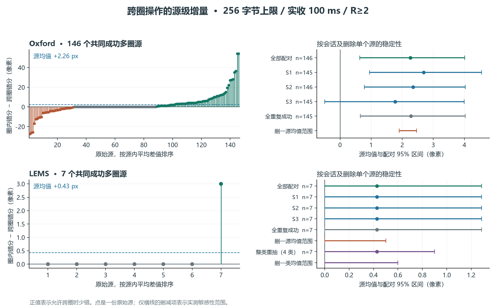

# POLY04 主控审核

**建议题名为《限时交付下保持部件与孔对应的二值蒙版编码》。** 允许把一个轮廓的顶点转给另一个轮廓，在冻结的 Oxford 多环主条件下保留了**小幅平均增量**。去掉了圈内短表的限制后，开发资料仍有增益；新 Oxford 的平均效应比开发时小，典型源的中位数为零。LEMS 的独立数据未建立该增量的外域复现。结构验收在部分图上有明显的面积代价，即使每个孔仍有身份，也可能只保留原面积的约三分之一。

## 加强的圈内搜索解释了多少

旧圈内先取全局 donor/receiver 短表，再过滤跨圈，可能没有把 24 个最终提案用满。新圈内从全部可用删除、插入单点中组成合法同圈配对，对同一预评分顺序精确取前 24。三角环可以在一次最终仍为三点的同圈操作中替点，跨圈给点后供体至少有三点。开发两轮里，旧圈内 59 轮有 15 轮不足 24 对，充分圈内只剩 1 轮不足，实际候选 1,267→1,392。两者均获准 57 次，30 个合格源的成品错分相同。三角替点在专门夹具中真实发生，26 字节的成品从 126 错降至 56 错。

在已知开发 Oxford 的 21 个多环共同成功源上，充分圈内在 100 ms 相对历史圈内平均**多错** 1.32 像素，区间涵盖持平。跨圈相对充分圈内仍少错 7.67 像素（95% 区间 2.75–13.59）。所以旧短表确有候选缺口，却解释不了同一开发集上的全部跨圈收益。新资料的涨幅下降也不能单独归因于换基线，样本和结构分布同时发生了变化。[开发消融、候选与真实计时](development.md) · [实现细节](../../records/poly04/engine-methods.md)

## 独立确认留下的增量

主条件固定为 256 字节上限、调用方实际收到的 100 ms、高精度环数 R≥2。比较双方使用相同 DP 合法起点、空间分辨率、真实 PM31 字节数与结构验收。错分是 FP+FN，表内“少错”取充分圈内减跨圈。只有相同源、会话、重复都交付合格文件时才配对；先在源内汇总重复和会话，再按源等权。所有输入另外进入覆盖率分母。

| 主条件 | 新 Oxford | 新 LEMS |
|---|---:|---:|
| 全部输入 / 多环源 / 共同及时成功多环源 | 200 / 150 / **146** | 100 / 10 / **7** |
| 共同成功多环重复对 | 871 | 42 |
| 圈内 → 跨圈的平均错分（像素） | 722.31 → 720.05 | 278.57 → 278.14 |
| 平均少错与 95% 源级配对区间 | **2.26 [0.64, 4.01]** | **0.43 [0.00, 1.29]** |
| 平均相对少错 | 0.292% | 0.120% |
| 平均 IoU 变化（百分点） | +0.00785 | +0.00596 |
| 按源改善 / 持平 / 退化 | 58 / 57 / 31 | 1 / 6 / 0 |
| 中位数 | 0 | 0 |

Oxford 的 FP 平均多 2.12、FN 平均少 4.38。BF1、BF2、BF3 平均分别提高 0.0634、0.0585、0.0393 个百分点，三者均只作评价。本方法没有 POLY02 的 BF2 下限。三次独立会话的平均少错为 2.69、2.35、1.78 像素，各会话均同向，第三会话单独的 95% 区间包含零。145 个全部六次都共同成功的源上平均少错 2.28 像素。删除任一源后均值为 1.90–2.47；最差源 miniature_pinscher_61 平均多错 27.5 像素，最好源 Ragdoll_32 平均少错 54。开发前登记的主效应区间、会话方向、删一源和全源覆盖四项均达标。这个结论支持平均的小效果，不能保证单图得益。[冻结判定](../../results/poly04/confirm/analysis/decision.json) · [逐源差值](../../results/poly04/confirm/analysis/source_pairs.csv)

## 覆盖与真实时间

Oxford 全部 200 源、1,200 次主条件调用中，跨圈交付 1,165 次（97.08%），充分圈内交付 1,166 次（97.17%）。双方共同成功 1,165 次，仅圈内成功 1 次，均未成功 34 次。全源覆盖差 −0.083 个百分点，区间 −0.25 至 0.00，位于预设 −2 pp 容忍度内。跨圈在 100 ms 有 12 次已返回搜索失败、23 次尚未收到，圈内分别为 12、22。该主条件的格式下界及不支持计数均为零。到 200 ms 双方各交付 1,182/1,200，剩余 18 次为已返回的搜索失败。这些失败均未填零误差。LEMS 两法均交付 528/600（88%），72 次未找到合法输出，无任何一方独有成功。全部预算、五种截止状态与四态终局均见[覆盖及强对照全表](tables.md)。

一个实测交付恰跨过截止：keeshond_55、S1/重复 2、256 B/within_full 的第三轮在 99.9987 ms 完成序列化，接收器在 100.0016 ms 才收到。100 ms 观测正确沿用第二轮。正式三会话共 12,168 次调用、50,191 个已交付检查点，3 个不同 Python/CGAL 进程顺序运行。对 6,748 个截止观测，后面仍有交付；94 个截止行是 not_ready。Oxford 跨圈在 256 B 下的搜索结束中位数约 209.96 ms、p95 230.99 ms，最长 244.38 ms。轮次跨越观察点的尾部完整保留，本实现不是硬实时系统。[原始回调复核](../../records/poly04/journal-check.json) · [实际交付](../../results/poly04/confirm/checkpoints.csv)

R=1 负对照中，Oxford 有 288 对及时文件，247 对完成相同轮数、这些字节全部一致；LEMS 486 对均相同。其余 Oxford 的时间差异会改变截止前走完的轮数。主条件的 200 ms 次要结果为 Oxford 少错 9.46（4.96–15.25），LEMS 仍少错 0.43（0–1.29）。128/512 字节仅在每域事前选定的 24 源上运行。在 Oxford 多环共同成功者上，100 ms 时分别少错 84.64（15 源）和 0.16（17 源），后者区间包含零。它们没有混入主估计。[次要与负对照](tables.md)

## 完整方法与 CGAL

原版 CGAL squared 每次独立建网与简化。CGAL 加共同充分圈内后处理严格验证原生目标点数、环身份和原尺寸结构。需要时只修正方向并建立循环索引；不合格则记录失败，未改用 DP。全部正式资料共 4,740 次 CGAL 原生调用，490 次起点被拒绝且没有替代文件。2,128 次合格的 CGAL 后处理调用核对了原生到规范化的起点。真实主数据没有需要逆向的环，反向夹具单独验证过。

在 256 B/100 ms 的 Oxford 全源共同成功比较中，跨圈完整方法相对原版 CGAL 平均少错 **105.76** 像素（190 源，94.37–117.58），相对 CGAL 加同样圈内后处理平均少错 **14.70** 像素（191 源，3.90–25.28）。原版 CGAL 比较中同时包含起点与后处理差异。跨圈自身的机制增量应看同一起点的 **2.26** 像素。跨圈与 CGAL 后处理在 1,200 次全源配对中有 29 次仅跨圈及时、18 次仅 CGAL 后处理及时。

CGAL 后处理相对自己同次调用的合法第 0 轮，100 ms 时在 194 个 Oxford 及时源上平均少错 **94.57** 像素。分别调用原版与后处理的 1,200 对可打包原生结果中，523 对原生字节不同，体现原库等价平局的运行差异。LEMS 对应为 55.68 像素与 27/600 对原生字节不同；DP 跨圈与 CGAL 后处理在 81 个共同成功外部源上平均少错 −0.29（−2.74 至 +2.19）像素。各自起点、不同调用和同域机制比较没有互相替代。[同次 CGAL 起点](../../results/poly04/confirm/cgal_own_start.csv) · [交付率和完整方法图](../../results/poly04/confirm/figures/delivery-and-baselines.png)

## 结构保留付出的代价

在 256 B 下，Oxford 的独立可加 DP 第一解有 188/200 个直接合法，12 个未能通过结构检验。有限分配池对其中 9 个找到了同实际码长、部件与孔正确对应的起点，3 个源仍未找到。**9 个修复源平均多错 128.89 像素**；按全部 197 个获得合法起点的源平均为 **5.89 像素**。最贵的 miniature_pinscher_95 从 1,815 错到 2,142 错，增加 327。这个数衡量初始化阶段为结构验收改选分配的成本。LEMS 的 88 个合法初值均直接通过，平均附加误差为 0。余下 12 个未找到，包含 10 个第一候选数字计数错误和 2 个未取得独立分配解，均有失败记录。[逐源反事实与真实文件](../../results/poly04/confirm/structural_cost.csv)

成功 PM31 必须保持前景部件、有限孔的身份对应和前景—背景邻接，但轮廓面积可以变化。Oxford 的 chihuahua_41 在同一次 254 字节交付中，从圈内的 655 错降至跨圈的 640 错，其中一个 2 像素部件却从覆盖 2 个像素降到 1 个。British_Shorthair_38 的一个参考孔有 271 像素，两法同次均只解码出 96 像素，参考覆盖率 **35.42%**。该例是共同近似的代价，不应归因于跨圈使孔再次缩小。正式表逐一给出参考面积、解码面积、相交面积、覆盖率、精确率、面积比及局部 IoU；面积比严格小于 0.5 和参考覆盖严格小于 0.5 分开计数。[逐区域表](../../results/poly04/confirm/regions.csv) · [最差部件和孔](../../results/poly04/confirm/analysis/regions_summary.csv) · [局部图](../../results/poly04/confirm/figures/cases-additional-Oxford.png)

在事前分层的精确整图补充中，审查 Oxford 24 源的 147 个实际检查点、3,528 对候选，以及 LEMS 19 源的 151 个检查点、3,624 对候选。此次没有发现被可加下降筛选漏掉的合法整图改善，首选动作也一致。在 Oxford 补充组，精确整图法于 100 ms 比可加路径平均多错 2.63 像素；LEMS 为零。两种目标在一般形状上没有等价保证，这里只报告所审查的路径和资源条件。[筛选检查](../../results/poly04/confirm/screen_summary.csv)

## 外部复现与最终定位

新名单排除了此前使用的 336 张 Oxford、既有 MPEG、作者示例、相应文件族及可辨识变体。Oxford 结构四层各 50 张，此处是**结构均衡评测分布**的均值。LEMS 100 个代表来自 7 个此前未作为该库评测主体的类别前缀。按规则只有 10 个多环形状、4 个相关类别；7 个共同成功者中只有 Robot055 少错 3 像素，其余 6 个持平。去掉该源或整个机器人类别后均值为 0。整类别重抽区间 0–0.90，**外域未复现稳定增量**。LEMS 没有完整实物 ID，文件族是来源排除和变换近重复聚类得到的代理。这些形状不能与 Oxford 照片混成单一像素均值。[输入隔离记录](../../records/poly04/data-report.md) · [类别敏感性](../../results/poly04/confirm/analysis/category_sensitivity.csv)

Oxford 的预登记典型源 Egyptian_Mau_46 在各次配对中平均少错 4.5，选作图示的实际重复为 313 对 313；持平源 Abyssinian_3 为 1,237 对 1,237；最差源 miniature_pinscher_61 图示为跨圈多错 33（1,402 对 1,369）。最大改善附例 Ragdoll_32 在同 254 字节下从 1,789 错降到 1,735。案例保留具体会话、重复、文件 SHA 和裁片坐标。它们解释收益分布与边界，不改变主判定。[Oxford 案例](../../results/poly04/confirm/figures/cases-Oxford.png) · [LEMS 案例](../../results/poly04/confirm/figures/cases-LEMS.png)

**可进入课程报告的贡献**是完整蒙版在真实码长、可观察交付时限及结构对应要求下的编码与验证；在结构均衡 Oxford 多环图上，跨圈操作相对最充分的同圈对照有小幅源平均增量。不能据此宣称所有形状获益、严格保住每个局部面积、BF2 有逐图下限、普遍跨域领先或人工编辑省时。POLY01–03 保留其原提交和结论，本轮没有重新开展其他研究线路。[复算入口与审核包](README.md)
